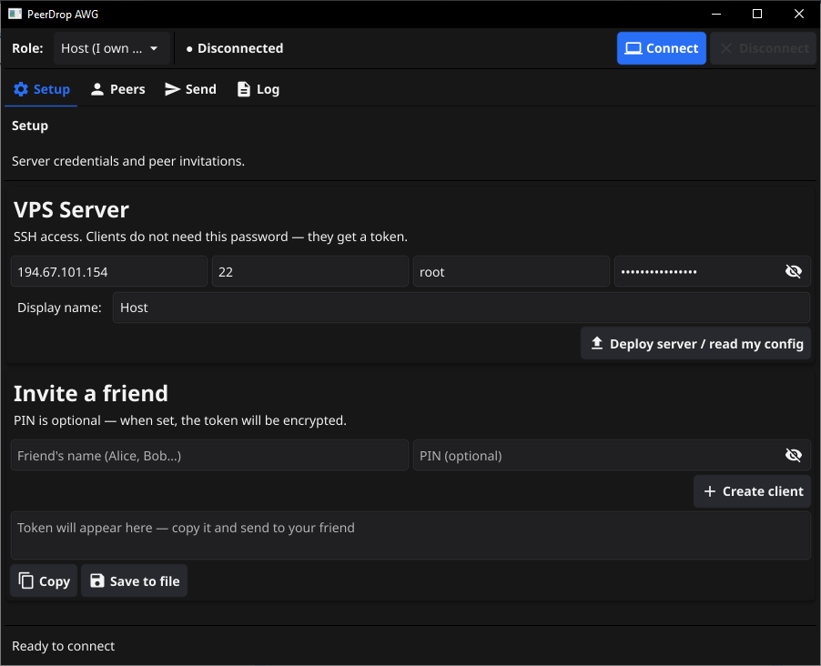
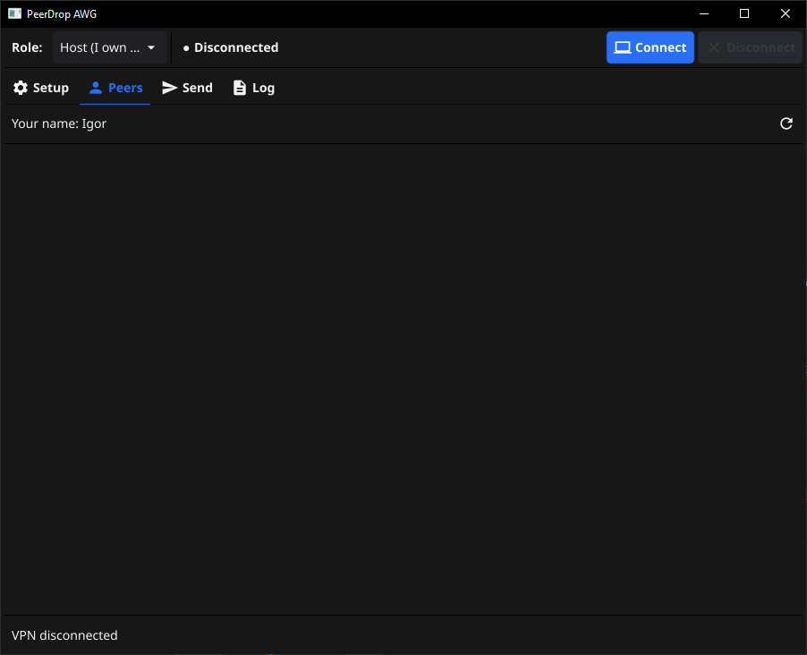
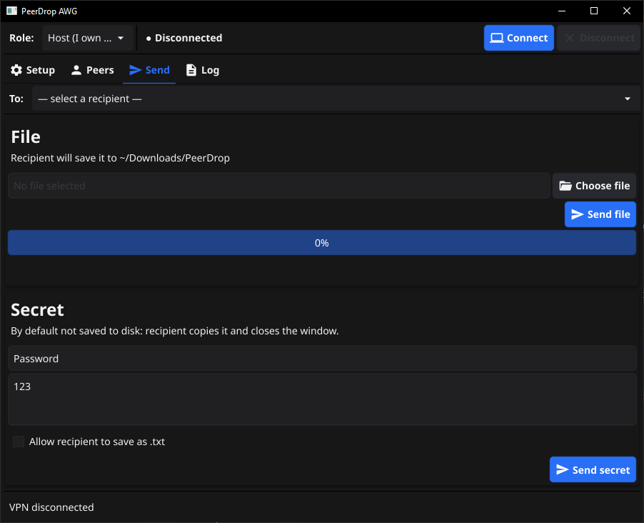
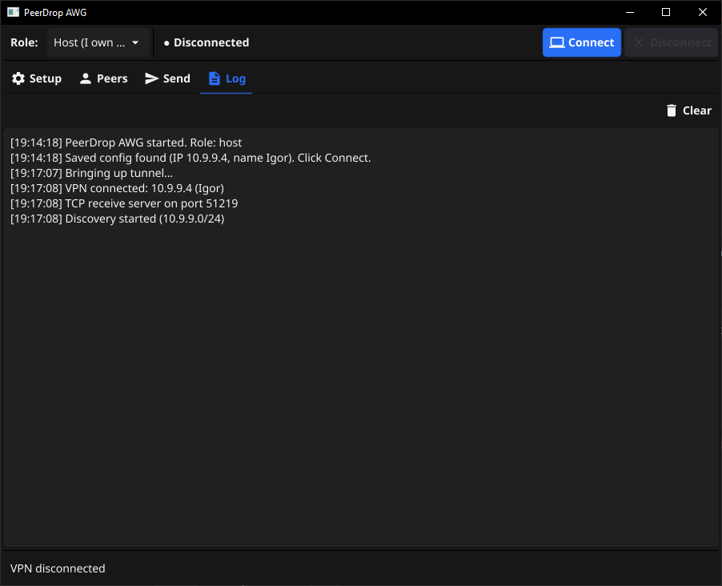

<div align="center">

# 📦 PeerDrop AWG

**A modern open-source desktop app for peer-to-peer, end-to-end encrypted file & secret sharing over an auto-deployed AmneziaWG VPN.**

Transfer files and secrets directly between computers — no cloud, no third-party servers, no NAT issues.

[](https://go.dev/)
[](https://fyne.io/)
[](https://amnezia.org/)
[](LICENSE)
[]()
[]()

[Features](#-features) • [Installation](#-installation) • [Usage](#-usage) • [Security](#-security-model) • [FAQ](#-faq) • [Support](#-support-the-project)

</div>

---

## 📖 About

**PeerDrop AWG** is a free, open-source desktop application that lets you transfer files and secrets directly between computers without any cloud services. It works by automatically deploying an [AmneziaWG](https://amnezia.org/) VPN server on your own VPS — after that, all peers join a private virtual network and see each other as if they were on the same LAN.

**Version 2.0.0 is a massive security update.** We added true End-to-End Encryption (E2E), cryptographic peer authentication, Trust On First Use (TOFU) key verification, and hardened the deployment process.

Perfect for:

- **Large file transfers** — videos, archives, anything — no size limits, no upload throttling.
- **Secret sharing** — send passwords, API keys or one-time codes that are **not written to disk** and encrypted E2E.
- **Cross-network transfers** — between home, office, or different countries, even behind strict NAT.
- **DPI bypass** — AmneziaWG obfuscation protects against deep packet inspection.

The app talks to your VPS only during the initial deployment. After that, files travel directly between peers over an encrypted VPN tunnel.

---

## ✨ Features

- 🚀 **One-click server deployment** — enter VPS IP + SSH password, the app installs AmneziaWG and configures everything automatically.
- 🎭 **Host / Client modes** — hosts manage the server and generate invite tokens; clients just paste a token.
- 🔐 **End-to-End Encryption (E2E)** — X25519 + ChaCha20-Poly1305. The VPS cannot read your files.
- 🛡️ **Cryptographic Identity** — Ed25519 keys authenticate peers and sign discovery packets.
- 🤝 **TOFU (Trust On First Use)** — Protects against MITM attacks. You can verify peer fingerprints in the UI.
- 🔑 **SSH Host Key Verification** — The app verifies the VPS's SSH fingerprint, preventing MITM during deployment.
- 📦 **Installer Integrity** — Server installer is verified via SHA-256 before running.
- 👥 **Peer discovery** — automatic and authenticated detection of online users in the VPN network.
- 📤 **File transfer** — send any file with progress bar and recipient confirmation. Auto-renames to avoid overwriting.
- 🔒 **Secret sharing** — send passwords or keys that are **not written to disk** by default. Clipboard clears after 30s.
- 🆓 **Free & open source** — no license keys, no subscriptions.

---

## 📸 Screenshots

<div align="center">

| Setup | Peers |
|:---:|:---:|
|  |  |

| Send | Log |
|:---:|:---:|
|  |  |

</div>

---

## 🚀 Installation

### Option 1: Download prebuilt executable (recommended)

Grab the latest release from the [Releases page](https://github.com/Igor-Shelloff/peerdrop-awg/releases/latest):

- **Windows** — `peerdrop-awg-win64.zip` (contains `peerdrop-awg.exe` and `wintun.dll`)

**Setup:**

1. Unzip **both files** (`peerdrop-awg.exe` and `wintun.dll`) into the same folder.
2. Right-click `peerdrop-awg.exe` → **Run as administrator**.

> ⚠️ **Important:** `wintun.dll` must be in the same folder as the executable. Without it, the app cannot create the VPN network adapter.

> ⚠️ **Windows SmartScreen:** The app is not code-signed. On first launch click **More info** → **Run anyway**. The source code is fully open — you can build it yourself.

### Option 2: Run from source

**Requirements:** Go 1.27 or newer, GCC (TDM-GCC for Windows), and `wintun.dll` next to the final binary.

```bash
git clone https://github.com/Igor-Shelloff/peerdrop-awg.git
cd peerdrop-awg
go mod tidy
go env -w CGO_ENABLED=1
go build -ldflags="-H windowsgui -s -w" -o peerdrop-awg.exe .
```

Place `wintun.dll` next to `peerdrop-awg.exe` and run as administrator.

---

## 📚 Usage

### Host mode (you own a VPS)

1. Launch the app and select **Host** mode in the top-right dropdown.
2. Fill in:
   - **VPS IP address** (e.g., `31.31.192.182`)
   - **SSH port** (default `22`)
   - **SSH user** (default `root`)
   - **SSH password**
   - **Your display name** — shown to other peers.
3. Click **Deploy server / read my config**.
   - Verify the SSH host key fingerprint if prompted.
   - The app connects via SSH, installs AmneziaWG 2.0, and configures the server.
   - ⏳ This takes **5–10 minutes** and the server may reboot **2–3 times** — this is normal. Do not close the app.
4. Once done, click **Connect** to join the VPN.
5. To invite a friend:
   - Enter their **name** and an optional **PIN** (highly recommended to encrypt the token).
   - Click **Create client**.
   - Copy the generated **token** and send it to them via any messenger.

### Client mode (you have a token)

1. Launch the app and select **Client** mode.
2. Paste the **token** you received from the host.
3. If the token was encrypted with a PIN, enter it in the **PIN** field.
4. Click **Apply and connect**.
5. The app automatically connects to the VPN and discovers other peers.

### Sending files & secrets

1. Go to the **Peers** tab and verify the recipient's fingerprint (optional, but recommended for maximum security).
2. Go to the **Send** tab.
3. Select the recipient from the **To:** dropdown.
4. **File:** choose a file → click **Send file**. Recipient confirms, file saves to `~/Downloads/PeerDrop` (auto-renamed if it exists).
5. **Secret:** enter a title and content → click **Send secret**. It will be delivered E2E encrypted.

---

## 🔐 Security Model

We want to be honest about what PeerDrop AWG protects against and what it doesn't. **Read this before sending anything sensitive.**

### What is protected

- **Traffic between each peer and the VPS** is encrypted and obfuscated by AmneziaWG. An outside observer (ISP, DPI) cannot see file contents or even recognize the traffic as a VPN.
- **End-to-End Encryption (E2E).** All files and secrets are encrypted directly between peers using ephemeral X25519 ECDH + ChaCha20-Poly1305. Your VPS only sees encrypted binary data.
- **Cryptographic Peer Authentication.** Every peer has an Ed25519 identity key. Discovery packets are signed, and connections require a mutual handshake. A peer cannot impersonate another peer.
- **Trust On First Use (TOFU).** When you connect to a new peer, their public key is saved. If their key ever changes later, the transfer will be blocked (possible MITM), and you must explicitly click **Forget peer** to reset trust.
- **SSH Host Key Verification.** The application verifies the VPS's SSH fingerprint using `known_hosts`. If the fingerprint changes, deployment is blocked.
- **Installer Integrity.** The server installer script is fetched from an immutable commit link and verified via SHA-256 before running.
- **Invite tokens** can be optionally encrypted with a PIN (AES-256-GCM + PBKDF2). Without the PIN, a leaked token is useless.
- **Files are not overwritten.** Received files are saved with a unique name (e.g., `file (1).txt`).
- **TCP Server isolation.** The receiving TCP server binds exclusively to the VPN IP address, completely invisible to your local network.
- **Secrets** are not written to disk by default. When copied, the clipboard automatically clears after 30 seconds.

### What is **not** protected

- **The VPS sees metadata.** While the VPS cannot read your files (thanks to E2E), it can see *that* peer A is connecting to peer B, and the approximate size of the files being transferred.
- **Read-once secrets are not securely wiped from RAM.** Go uses a garbage collector and immutable strings — copies of the secret may remain in RAM until the process exits.

### Recommendations

- ✅ Safe for: family photos, videos, large archives, documents, passwords, source code.
- ✅ You can safely use a VPS you don't fully trust for data confidentiality (thanks to E2E).
- ⚠️ Avoid running PeerDrop on a compromised local machine (malware can read RAM).

---

## 🧠 How it works

```
┌─────────────┐         ┌──────────────────┐         ┌─────────────┐
│   Host PC   │◄───────►│   VPS (Ubuntu)   │◄───────►│  Client PC  │
│             │  SSH    │   AmneziaWG      │  UDP    │             │
│  PeerDrop   │────────►│   VPN Server     │◄────────│  PeerDrop   │
│             │ deploy  │  10.x.x.1/24     │  VPN    │             │
└─────────────┘         └──────────────────┘         └─────────────┘
       ▲                                                    ▲
       │           E2E Encrypted VPN tunnel                 │
       └────────────────────────────────────────────────────┘
                    (VPS only sees encrypted data)
```

1. The host uses SSH to deploy AmneziaWG on a VPS.
2. Each peer receives a client config (as an invite token) and connects to the VPN.
3. All peers join a virtual LAN (e.g., `10.9.9.0/24`).
4. Peer discovery uses UDP unicast sweep across the subnet. Packets are Ed25519 signed.
5. File/secret transfer uses TCP directly between peers, protected by an additional E2E layer.

---

## ❓ FAQ

**Q: Do I need a VPS?**
Only the host needs a VPS. Clients just need the invite token.

**Q: Is this really peer-to-peer?**
For discovery and transfer logic — yes, peers address each other directly. For the network path — traffic is routed through the VPS because it's a hub-and-spoke VPN.

**Q: Can the VPS owner read my files?**
No. Version 2.0.0 introduced End-to-End Encryption (X25519 + ChaCha20-Poly1305). The VPS only sees encrypted binary data. However, the VPS can see *metadata* (who is talking to whom, and file sizes).

**Q: What if DPI blocks WireGuard?**
AmneziaWG uses obfuscation (fake DNS packets, header randomization) specifically to bypass DPI. That's why we chose it over standard WireGuard.

**Q: Where are received files saved?**
`~/Downloads/PeerDrop` (Windows: `C:\Users\<you>\Downloads\PeerDrop`). If a file with the same name exists, it is saved as `file (1).txt`.

**Q: Can I use this on macOS or Linux?**
The code has stubs for Linux/macOS, but only Windows is tested. Contributions welcome.

**Q: I get "Access denied" when connecting.**
Run the app as **administrator**. Creating a TUN adapter requires elevated privileges.

---

## 🛠 Tech Stack

- **[Go 1.27+](https://go.dev/)** — core language.
- **[Fyne](https://fyne.io/)** — cross-platform GUI toolkit.
- **[amneziawg-go](https://github.com/amnezia-vpn/amneziawg-go)** — WireGuard fork with obfuscation.
- **[wintun](https://www.wintun.net/)** — Windows TUN adapter driver.
- **[goph](https://github.com/melbahja/goph)** — SSH client for remote deployment.
- **[x/crypto](https://pkg.go.dev/golang.org/x/crypto)** — ChaCha20-Poly1305, X25519, Ed25519, HKDF.

---

## 💖 Support the Project

If this tool saved you time and you'd like to say thanks:

- ⭐ **Star the repo** — it helps other people find it.
- 🐛 **Report bugs** or suggest features in [Issues](https://github.com/Igor-Shelloff/peerdrop-awg/issues).
- 💰 **Donate** — [Boosty](https://boosty.to/igorshelloffdev).
- 📩 **Contact** — [@igor_shelloff](https://t.me/igor_shelloff).

Every star and issue helps make the project better.

---

## 📄 License

This project is licensed under the **MIT License** — see the [LICENSE](LICENSE) file for details.

You're free to use, modify and distribute it, including commercially. Attribution is appreciated but not required.

---

## 👤 Author

**Igor Shilov** — Full-Stack Developer

- GitHub: [@Igor-Shelloff](https://github.com/Igor-Shelloff)
- Telegram: [@igor_shelloff](https://t.me/igor_shelloff)
- Email: igor.shilov93@mail.ru